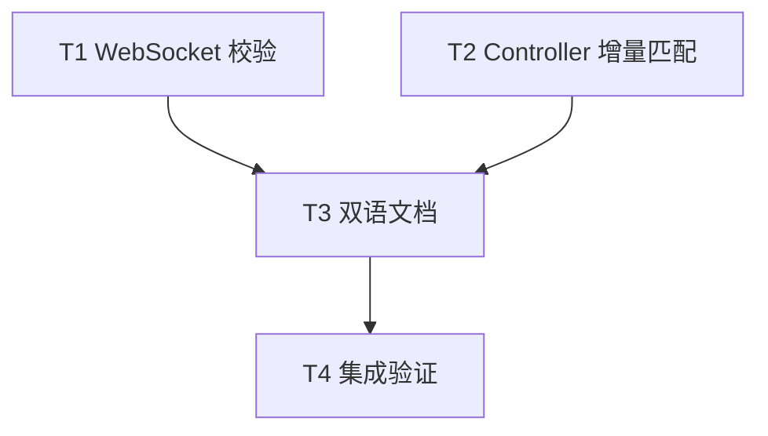

# rs-web WebSocket 策略校验与 Controller 路由装配实施计划

> 状态：本文涉及的 WebSocket 最终值校验由 `def7606` 实施，Controller 增量路由装配由 `4b679d6` 实施，相关文档同步由 `e62f3ab` 完成。本文中的待办与授权说明仅保留为写作时的历史记录。

> 面向下一位执行者：按下列任务和依赖实施；本文只授权规划，不表示本轮已经修改源码。设计依据：[设计文档](design-20261013T043730450Z-e89680a2.md)。任务进度用复选框记录。

**目标：** WebSocket 策略按最终字段值校验并报告准确的超容量错误；Controller 路由装配增量复用匹配器；同步测试、Rustdoc 和中英文使用文档。

**架构：** `PolicyInner` 保存最终原始配置，`validate()` 不维护历史错误标记；无效连接上限只创建零容量 Semaphore，防止构造时 panic。`ControllerRoutes` 拥有持久 `matchit::Router<()>`，逐次插入新模板；`add` 失败时 builder 被消费，因此预检过程中不需复制既有状态。

**技术栈：** Rust 2024（最低 1.94）、Axum 0.8、Tokio 1、matchit 0.8；不增加依赖。

**文档位置：** 本文件与设计文档均在目标仓库 `doc/`，使用用户指定文件名。用户已授权直接产出并执行后续方案所需的文档，无临时工作区或文档审批步骤。未经用户另行授权，不执行 `git add`、`git commit` 或 `git push`。

## 全局约束

- 允许 `WsPolicyError` 增加公共枚举变体；不要求旧版本穷尽匹配代码保持兼容。
- 保留 `WsUpgradePolicy::on_upgrade` 的认证、Origin、接纳及 HTTP 拒绝顺序；无效 policy 仍返回 HTTP 500。
- 保留 policy 克隆共享容量域、重新设置 `max_connections` 创建新容量域的合同。
- 保留 `ControllerRoutes::add(self, Arc<C>) -> Result<Self, ControllerRouteError>` 签名、错误分类、注册前预检和 Controller 短请求限额共享方式。
- 历史设计记录不改写；中英文现行文档语义保持一致。
- 只修改下列任务明确列出的相关文件；不修改 rs-websocket 的 Git revision 或其他下游仓库。
- 源码改动时按项目规则读取适用的 Rust 编码、Rustdoc 与测试规则；最终验证依赖真实命令输出，不以先前评审的测试结果替代。

## 文件与职责

| 文件 | 预期改动 |
| --- | --- |
| `src/ws/internal/policy_inner.rs` | 去掉累积 `invalid_limits`，保留最终连接上限与安全 Semaphore。 |
| `src/ws/ws_upgrade_policy.rs` | setter 和 `validate()` 改按最终值判断；更新 Rustdoc。 |
| `src/ws/ws_policy_error.rs` | 增加 `ConnectionLimitTooLarge` 及说明。 |
| `tests/websocket_tests.rs` | 补最终值修正、跨字段错误、超上限和活动计数回归。 |
| `src/mvc/controller_routes.rs` | 持久化匹配器，增量预检，更新 Rustdoc。 |
| `tests/controller_routes_tests.rs` | 复用已有跨 Controller 行为测试；只在发现未覆盖的外部行为时补测试。 |
| `README.md`、`README.zh_CN.md` | 简述 WebSocket 最终值校验及错误类别。 |
| `doc/user_guide.md`、`doc/user_guide.zh_CN.md` | 说明设置修正、容量边界及错误处理。 |
| `doc/2026-10-09-rs-web-architecture.en.md`、`doc/2026-10-09-rs-web-architecture.zh_CN.md` | 更新路由预检机制与策略配置合同。 |
| `doc/2026-10-09-rs-web-lifecycle-design.en.md`、`doc/2026-10-09-rs-web-lifecycle-design.zh_CN.md` | 补充 WebSocket 策略最终状态校验说明。 |

## 调度图

| 任务 | 前置任务 | 最小解锁产物 | 写入集合 | 本地验证 | 集成验证归属 | 审查时机 |
| --- | --- | --- | --- | --- | --- | --- |
| T1 WebSocket 校验 | 无；与 T2 同一可并行批次 | 代码和聚焦回归通过 | `src/ws/internal/policy_inner.rs`、`src/ws/ws_upgrade_policy.rs`、`src/ws/ws_policy_error.rs`、`tests/websocket_tests.rs` | `cargo test --all-features --offline --test websocket_tests` | T4 | 立即审查 |
| T2 Controller 增量匹配 | 无；与 T1 同一可并行批次 | 代码和现有路由回归通过 | `src/mvc/controller_routes.rs`；必要时 `tests/controller_routes_tests.rs` | `cargo test --offline --test controller_routes_tests` | T4 | 立即审查 |
| T3 双语文档 | T1、T2 | 行为合同已确定，文档同步 | `README.md`、`README.zh_CN.md`、上述六份现行 `doc/` 文档 | 手工核对双语对应段落、链接和示例 | T4 | 批量审查 |
| T4 集成验证 | T3 | 全部任务完成 | 无源码写入；若失败，交回对应任务修正 | `git diff --check` 与验证命令 | T4 独占昂贵门禁 | 立即审查 |

T1 与 T2 写入集合互不相交，可同时实施；若使用同一 `target/`，两个聚焦 Cargo 命令归入同一资源组并串行执行。全量测试、Clippy、Rustdoc 和 feature matrix 仅在 T4 运行一次。

## 任务拓扑依赖图



## T1：WebSocket 策略按最终值校验

**输入：** 当前 `WsUpgradePolicy`、`PolicyInner` 与 `WsPolicyError`。**输出：** 原签名 `validate(&self) -> Result<(), WsPolicyError>` 保持，新增 `WsPolicyError::ConnectionLimitTooLarge`。

- [ ] 在 `tests/websocket_tests.rs` 增加聚焦测试。至少覆盖每个 setter 的无效值被有效值覆盖、一个字段已修正但另一个仍无效、`MAX_PERMITS + 1` 返回新错误，以及超上限 policy 的 `active_connections() == 0`。断言示例：

  ```rust
  assert_eq!(WsUpgradePolicy::new().max_connections(0).max_connections(1).validate(), Ok(()));
  assert_eq!(WsUpgradePolicy::new().max_frame_bytes(0).max_frame_bytes(1).validate(), Ok(()));
  assert_eq!(
      WsUpgradePolicy::new().max_message_bytes(0).queue_limits(0, 1).max_message_bytes(1).validate(),
      Err(WsPolicyError::ZeroLimit),
  );
  assert_eq!(
      WsUpgradePolicy::new().max_connections(tokio::sync::Semaphore::MAX_PERMITS + 1).validate(),
      Err(WsPolicyError::ConnectionLimitTooLarge),
  );
  ```

- [ ] 运行 `cargo test --all-features --offline --test websocket_tests test_corrected_policy_limits_are_valid`（实际测试名与命令一致），确认新用例在修改生产代码前因当前累积标记或缺少错误变体而失败；记录失败原因。
- [ ] 在 `PolicyInner` 删除 `invalid_limits`。在 `max_connections(limit)` 中保留最终原始 `limit`，仅当它在 `1..=Semaphore::MAX_PERMITS` 内时用该值构造 Semaphore，否则用 0。其他 setter 仅修改各自字段，不记录历史错误。
- [ ] 在 `WsPolicyError` 加入无数据字段的 `ConnectionLimitTooLarge`。`validate()` 按设计文档的固定顺序检查最终字段；`active_connections()` 对无效连接上限返回 0。核心逻辑应满足：

  ```rust
  if self.inner.max_connections == 0 { return Err(WsPolicyError::ZeroLimit); }
  if self.inner.max_connections > Semaphore::MAX_PERMITS {
      return Err(WsPolicyError::ConnectionLimitTooLarge);
  }
  if self.inner.max_frame_bytes == 0 || self.inner.max_message_bytes == 0
      || self.inner.queue_messages == 0 || self.inner.queue_bytes == 0
      || self.inner.idle_timeout.is_zero()
  {
      return Err(WsPolicyError::ZeroLimit);
  }
  Ok(())
  ```

- [ ] 更新三个相关源码文件的 Rustdoc，尤其写明超上限错误与“后续 setter 覆盖前值”的合同。运行 `cargo test --all-features --offline --test websocket_tests`；预期该测试目标全部通过，现有 Origin、限额和关闭测试没有回归。

## T2：ControllerRoutes 增量匹配

**输入：** 现有 `ControllerRoutes<S>` 与 `ControllerDefinition<S>`。**输出：** 公共签名不变，builder 内部新增 `matcher: matchit::Router<()>`。

- [ ] 先运行 `cargo test --offline --test controller_routes_tests`，记录当前跨 Controller 冲突、同路径不同方法、非法路径及注册前预检测试结果。该任务是内部性能重构；现有外部行为测试是回归门禁，不要求为内部缓存字段编写镜像测试。
- [ ] 在 `ControllerRoutes<S>` 增加私有 `matcher` 字段，在 `new()` 使用 `matchit::Router::new()` 初始化。删除 `add` 开头对 `declared` 的克隆及从旧路径重建 `matcher` 的循环。
- [ ] 将 `add` 中的 preflight 改为直接更新 `self.declared` 和 `self.matcher`；同路径不同方法只插一次模板。保持现有错误映射与完整 preflight 后才调用 `C::register` 的顺序。关键骨架：

  ```rust
  for route in C::route_metadata() {
      if self.declared.get(route.path()).is_some_and(|methods| methods.contains(route.method())) {
          return Err(ControllerRouteError::DuplicateMethod {
              method: route.method(), path: route.path(),
          });
      }
      if !self.declared.contains_key(route.path()) {
          self.matcher.insert(route.path(), ()).map_err(|error| match error {
              matchit::InsertError::Conflict { with } => ControllerRouteError::PatternConflict {
                  path: route.path(), existing_path: with,
              },
              error => ControllerRouteError::InvalidPath {
                  path: route.path(), reason: error.to_string(),
              },
          })?;
      }
      self.declared.entry(route.path()).or_default().insert(route.method());
  }
  self.router = C::register(controller, self.router, self.limit_state.clone());
  ```

- [ ] 更新 `add` 的 Rustdoc，写清失败时消费 builder、Router 注册只发生在全部 metadata 通过后。运行 `cargo test --offline --test controller_routes_tests`；预期原有测试全部通过。若发现真实缺口，再补一个连续添加 Controller 后检查首尾路由可访问的外部行为测试，不测试内部 `matcher` 字段。

## T3：同步中英文文档

**输入：** T1、T2 的最终公共合同。**输出：** 中英文 README、用户指南与现行设计摘要准确且同义。

- [ ] 在 `README.md` 与 `README.zh_CN.md` 的 WebSocket policy 说明附近各加入一句：策略按最终设置值校验；零值与超过 `Semaphore::MAX_PERMITS` 的连接上限分别对应 `ZeroLimit` 与 `ConnectionLimitTooLarge`。不改其他使用场景。
- [ ] 在 `doc/user_guide.md` 与 `doc/user_guide.zh_CN.md` 的容量／故障定位小节加入相同合同和可复制的 `max_connections` 修正示例；确认示例使用真实 API 名，说明错误变体而不暗示无效策略可升级。
- [ ] 在两份现行架构摘要的路由装配段落说明 matcher 增量复用只改变装配成本，错误分类与路由行为不变；在 WebSocket 容量段落说明最终值范围。两份生命周期摘要的策略段落补充最终配置校验和超上限错误。历史 2026-10-08 设计记录保持原样。
- [ ] 对照八份文件的中英文对应段落逐项检查术语、数值 `1..=Semaphore::MAX_PERMITS`、链接和示例；预期含义一致，无过时的“任何历史非法值永久失败”描述。

## T4：集成验证与交付核对

**输入：** T1、T2、T3 全部完成。**输出：** 可审阅的最终 diff 与完整门禁结果。

- [ ] 运行 `git diff --check` 和 `git diff --stat`，核对只有任务列出的相关源码、测试和文档被修改；逐项对照设计文档的合同。
- [ ] 运行 `cargo test --workspace --all-features --offline` 与 `cargo test --workspace --no-default-features --offline`，确认单元、集成、trybuild 和 Rustdoc 测试全部通过。
- [ ] 运行 `cargo clippy --workspace --all-targets --all-features --offline -- -D warnings`、`RUSTDOCFLAGS='-D warnings' cargo doc --workspace --all-features --no-deps --offline`、`./.infra/bin/style-check.sh`。若项目固定的 Clippy 工具链或 style 命令与这些命令不同，先检查 `.infra` 配置并使用项目规定入口，记录实际命令与结果。
- [ ] 按 `.infra/ci/cargo-matrix.json` 逐项执行 feature matrix 的 `check`、`test`、`doc` 组合，或使用已检查确认等价的项目 CI 入口；避免重复执行已经完全等价的组合，并记录省略依据。确认 `ws` 单独 feature 与无默认 feature 均可编译。
- [ ] 复核公开 `WsPolicyError` 新变体是否在 Rustdoc 和双语文档出现；复核 `ControllerRoutes::add` 仍在注册前返回既有错误；检查 `git status --short`。不在无授权情况下提交或推送。

## 规格覆盖核对

| 设计要求 | 任务 |
| --- | --- |
| 最终值校验、无效值覆盖、超上限错误、无效 policy 活动数 | T1 |
| 保留 WebSocket 容量域与升级拒绝顺序 | T1、T4 |
| Controller 增量 preflight、错误分类、注册时机与公共签名 | T2、T4 |
| 测试覆盖及真实功能矩阵 | T1、T2、T4 |
| Rustdoc 与中英文 README／指南／现行设计摘要同步 | T1、T2、T3、T4 |
| 下游旧 revision 仅作参考、不修改其他仓库 | T4 |
