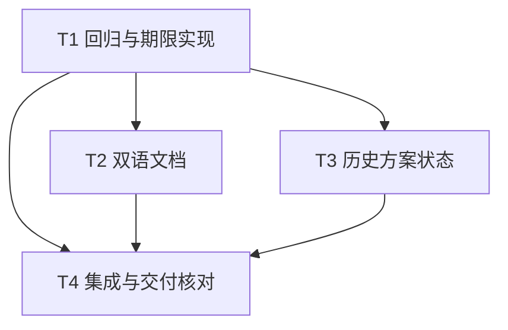

# rs-web 短响应期限与文档状态修复实施计划

> **历史状态：已实施。** `f3dab76` 实现短响应期限清理，`1bd017a` 同步使用文档。下文的“本轮未修改源码”“不授权”等均是本计划写作时的状态记录；现行合同以双语用户指南和架构摘要为准。

> 面向当时的执行者：按复选框逐项实施。设计依据：[设计文档](design-20261013T073858154Z-7cc1c7fc.md)。本文件保留该轮原始执行约束作为历史记录。

**目标：** 即使短响应体停止被轮询，也在绝对期限到达时丢弃应用 body 并归还并发许可；同步测试、双语文档和本地历史方案状态。

**架构：** `PermitBody` 以共享阶段状态协调正常轮询、超时看守任务和提前丢弃。看守任务独立于传输轮询，在期限到达时取走 body 与许可；后续轮询只报告一次超时错误。HTTP 连接上限与短请求许可继续独立。

**技术栈：** Rust 2024、最低 Rust 1.94、Axum 0.8、Tokio 1、Hyper 1；不增加依赖。`permit_body(inner, permit, deadline) -> Body` 保持现有内部调用签名。

**文档位置：** 设计和计划都位于用户指定的 `rs-web/doc/` 路径；不使用临时工作区，不覆盖既有文件。

## 全局约束

- 仅改动短响应期限所需的 `limit` 源码、相关测试与 Rustdoc、受影响的中英文 README／用户指南／现行架构摘要，以及两份已存在的本地未跟踪历史方案。
- 不修改 SSE、WebSocket、Controller、TLS、JSON、下游仓库或无关格式。既有 HTTP 状态、错误码、短路由选取方式与绝对期限起点保持不变。
- 不承诺超时后客户端立即收到新 HTTP 状态；响应头之后只能由 body error 表示超时。到期后应用 body 不再产生帧，许可与生产者无需等待下一次轮询即可释放。
- 修改 Rust 代码或测试前读取当前任务适用的项目及全局按需规则；任何待清理的重要文件仍需按用户授权处理。
- 不执行 `git add`、`git commit`、`git push`，不删除文件。不要把旧设计稿仍为未跟踪状态误认为可以覆盖或丢弃。

## 文件与接口映射

| 路径 | 职责 |
| --- | --- |
| `src/limit/internal/permit_body.rs` | 共享状态、到期看守、响应体轮询与资源释放 |
| `src/limit/request_limit_layer.rs` | 确认同一绝对期限和响应体包装调用；只在必要时改动 |
| `src/limit/http_limits.rs` | `with_request_timeout` Rustdoc 合同 |
| `tests/http_limits_tests.rs` | 未轮询、轮询中、提前丢弃、网络背压的行为回归 |
| `README.md`、`README.zh_CN.md` | 双语短请求期限摘要 |
| `doc/user_guide.md`、`doc/user_guide.zh_CN.md` | 双语操作边界与故障排查 |
| `doc/2026-10-09-rs-web-architecture.en.md`、`doc/2026-10-09-rs-web-architecture.zh_CN.md` | 现行架构资源边界 |
| `doc/design-20261013T043730450Z-e89680a2.md`、`doc/implementation-plan-20261013T043730450Z-e89680a2.md` | 本地历史方案状态说明，保留正文 |

## 调度图

| 任务 | 前置任务 | 最小解锁产物 | 写入集合 | 本地验证 | 集成验证归属 | 审查时机 |
| --- | --- | --- | --- | --- | --- | --- |
| T1 回归与期限实现 | 无 | 未轮询 body 到期后主动 `Drop` 并归还许可，聚焦测试通过 | `src/limit/internal/permit_body.rs`、`src/limit/request_limit_layer.rs`、`src/limit/http_limits.rs`、`tests/http_limits_tests.rs` | `cargo test --test http_limits_tests --all-features --offline` | T4 | 立即审查；编译与测试资源组 cargo |
| T2 双语文档 | T1 | 与已验证行为一致的双语使用合同 | `README.md`、`README.zh_CN.md`、两份用户指南、两份现行架构摘要 | 手工逐段对照代码与双语段落 | T4 | 批量审查；可与 T3 并行 |
| T3 历史方案状态 | T1 | 两份旧方案顶部标明已实施及提交依据 | 两份 2026-10-13 旧方案 | `sed -n '1,8p'` 分别读取两个精确路径 | T4 | 批量审查；可与 T2 并行 |
| T4 集成与交付核对 | T1、T2、T3 | 全量门禁、最终 diff 与文件清单 | 无源码写入；发现问题返回责任任务修正 | `git status --short`、`git diff --check`，并直接读取未跟踪文件 | 本任务独占全量 cargo 门禁 | 立即审查；cargo 重型命令串行 |

## T1：回归与期限实现

**接口：** 保持 `permit_body(inner: Body, permit: Option<OwnedSemaphorePermit>, deadline: tokio::time::Instant) -> Body`。内部可定义 `SharedBodyState` 和 `Phase::{Active, TimedOut, Finished}`；后续任务只依赖对外可观察行为。

- [ ] 在 `tests/http_limits_tests.rs` 添加 `unpolled_response_body_deadline_releases_capacity_and_drops_source`。复用 `NeverEndingResponse` 思路，增加 `Drop` 时设置 `Arc<AtomicBool>` 的 body；以并发上限 1、约 30 ms 期限创建首个响应，**不轮询它**，等待超过期限后确认 `Drop` 标记，再调用同层的 `/ok` 并断言 200；最后轮询旧 body，断言第一次为 `TimedOut` 错误、第二次为 `None`。所有等待加 1 秒外层超时。
- [ ] 运行 `cargo test --test http_limits_tests unpolled_response_body_deadline_releases_capacity_and_drops_source --all-features --offline`，确认旧实现失败于生产者未被丢弃或第二请求返回 503；若测试未红，修正测试使它确实覆盖未轮询条件。
- [ ] 在 `src/limit/internal/permit_body.rs` 引入一个由 `Arc<Mutex<...>>` 共享的阶段状态。`Active` 拥有 `Body`、`OwnedSemaphorePermit` 和最近的 `Waker`；`TimedOut` 不再拥有 body/许可但保留“错误尚未交付”标志；`Finished` 表示无后续帧。状态转移只能在同一锁下发生，取出的 body/许可和 waker 在锁外销毁或唤醒。
- [ ] 对非空 body 启动 `tokio::spawn(async move { sleep_until(deadline).await; expire(shared); })`；`expire` 仅在 `Active` 时转为 `TimedOut`，主动丢弃应用 body 并归还许可。包装器在正常 EOF、body error 或自身 `Drop` 时同步从共享状态取走并释放 body 与许可，再取消看守任务；不能仅 `abort` 后等待运行时回收资源。使用 `JoinHandle::abort()` 或等价机制，证明没有长期 detached 任务。互斥锁中毒时按项目已有模式取回内部状态，仍完成释放。
- [ ] 实现 `poll_frame`：先按绝对时间处理到期，再在 `Active` 阶段轮询应用 body；`Pending` 登记 waker；EOF/error 转为 `Finished` 并释放许可；`TimedOut` 第一次返回 `axum::Error` 包装的 `io::ErrorKind::TimedOut`，其后返回 `None`。`is_end_stream`、`size_hint` 与阶段一致，保证超时错误尚未交付时不会被误报为 EOF。不要在持锁期间 `.await`、销毁应用 body 或唤醒 waker。
- [ ] 运行聚焦测试与已有 `response_body_deadline_releases_short_request_capacity`、`permit_is_held_until_response_body_eof`、`response_body_error_releases_short_request_capacity`、`dropping_unconsumed_response_body_releases_short_request_capacity`；确认正常路径、超时路径与提前丢弃均通过。
- [ ] 增加超时与提前 `Drop` 邻近时序测试，使用容量 1 与可观察 body `Drop` 计数，断言只丢弃一次且下一请求获准。增加真实 `WebServer` 慢客户端测试：读取响应头后停止读取持续产出定量小块的流，期限后通过另一连接访问同限额域短路由，断言成功；外层超时并完成服务关闭。避免依赖固定 socket 缓冲大小。如果无法稳定触发背压，保留确定性未轮询测试为必需门禁，并在测试注释与交付说明中记下网络测试限制。
- [ ] 更新 `RequestLimitLayer`、`HttpLimits::with_request_timeout` 和内部包装器 Rustdoc：解释许可与生产者按期限主动释放、响应头后只能出现 body error，以及底层传输收到错误的时间依赖后续轮询。运行 `cargo test --test http_limits_tests --all-features --offline`。

## T2：双语文档

**前置接口：** T1 的实测合同；不能仅根据本设计稿描述未经验证的行为。

- [ ] 在 `README.md:61` 与 `README.zh_CN.md:61` 的短请求限额条目加入“超时不依赖下一次响应体轮询即可释放应用 body 和短请求许可”。保留 Controller 默认值与原生 Axum 显式安装要求。
- [ ] 在 `doc/user_guide.md` 与 `doc/user_guide.zh_CN.md` 的短请求及故障排查段落解释：handler 超时返回 504；响应头之后到期只能终止 body，慢客户端是否立即观察到错误取决于传输继续读取；传输连接仍受独立容量策略约束。避免把许可回收写成立即关闭 TCP/HTTP/2 连接。
- [ ] 在两份现行架构摘要的“Controller short requests/短请求”资源表与相邻生命周期说明中同步上述边界。逐段核对中英文数值、错误状态、触发条件与限制一致；检查 Markdown 链接仍有效。

## T3：历史方案状态

**前置接口：** T1 已确认本轮方案不重复实现旧 WebSocket 与 Controller 改进。

- [ ] 先以 `git status --short` 和全文读取确认两份旧方案仍是用户原有未跟踪文件，且顶部仍写“待实施”。若内容已变化，按当前内容做最小增补。
- [ ] 只在 `doc/design-20261013T043730450Z-e89680a2.md` 和 `doc/implementation-plan-20261013T043730450Z-e89680a2.md` 顶部加入状态行：对应方案已由 `def7606`、`4b679d6`、`e62f3ab` 实施和同步；文中未来时描述保留为写作时的历史记录。不要删除、重命名、重写正文，也不要把这两份文件加入正式文档索引。
- [ ] 对照 `git log -3 --oneline`、两个文件首段和 `git status --short`，确认提交引用准确且仅新增状态说明。

## T4：集成与交付核对

- [ ] 按设计文档逐条核对 T1 的主动丢弃、许可归还、单次 body error、正常终止及 race 处理；核对 T2 双语含义与 T3 历史状态。检查 `git diff --check`、`git diff --stat`、`git status --short`，并直接读取所有未跟踪文档的首尾和关键段落；普通 `git diff` 不显示未跟踪文件，不能据此宣称它们已核对。确认没有无关改动或文件删除。
- [ ] 串行运行 `cargo fmt --all -- --check`、`cargo test --workspace --all-features --offline`、`cargo test --workspace --offline`、`cargo doc --workspace --all-features --no-deps --offline`、`cargo clippy --workspace --all-targets --all-features --offline -- -D warnings`。如需运行仓库风格脚本，先检查其实际操作范围；仅在确定不会改写或清理重要文件后运行。
- [ ] 如新测试或门禁失败，回到负责该路径的任务修正并重跑失败的聚焦命令，最后重新跑受影响的集成门禁。交付时列出实际运行的命令与结果、未验证项、公开行为变化和仍存在的传输层边界；不要声称 rs-websocket 的旧 revision 互操作测试证明当前提交兼容。

## 自检映射

| 设计必须项 | 任务 |
| --- | --- |
| 未轮询时主动丢弃应用 body 并归还许可 | T1 |
| 现有 HTTP 状态与超时 body error 合同 | T1、T2 |
| 正常 EOF、错误、Drop、超时竞争下单次释放 | T1 |
| 双语 README、用户指南、架构摘要与 Rustdoc 同步 | T1、T2 |
| 两份旧方案标明已实施且保留正文 | T3 |
| 聚焦、网络、全量与风格验证 | T1、T4 |
