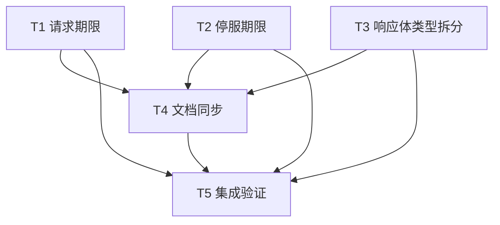

# rs-web 期限溢出与文档状态修复实施计划

> 实施记录：本计划所列源码、测试与文档任务均已完成，集成验证与 CI 对齐通过。复选框记录本次执行结果；详细命令见本轮实施交付摘要。

**目标：** 消除已核实的请求与停服绝对期限溢出 panic，修正历史方案状态，并将响应体私有类型按项目风格拆分。

**架构：** 配置时用 `Instant::checked_add` 尽早拒绝不可表示的期限，运行时再次检查并走明确的 HTTP 错误或有清理的停服错误。响应体阶段状态只移动文件，不改变生命周期。历史设计记录保留原正文，顶部标注实际实施状态。

**技术栈：** Rust 2024、最低 Rust 1.94、Axum 0.8、Tokio 1、Hyper 1；不新增依赖。允许新增 `WebRejection` 变体和 crate 内接口变化，无须保留穷尽匹配兼容性。

**文档位置：** 本计划与设计均使用用户指定的 `rs-web/doc/` 精确路径，不创建临时方案目录，不覆盖已有文件。

## 全局约束

- 只修改本设计所列代码、测试和直接受影响文档；不改动现有短响应看守任务的行为与资源释放合同。
- 先读取当前项目 `AGENTS.md` 与适用的全局按需规则；修改 Rust 生产代码、Rustdoc、测试时组合读取相应规则。
- 用户已明确授权按计划实施、分组提交、worktree 合并、分支快进同步及推送；不删除或移动重要文件。新增两个内部 Rust 文件、修改既有文件与历史文档属于已接受意见的实施范围。
- 多个任务可并行编辑互不相交的文件；同一仓库的 cargo 编译与测试共用 target/cache，重型命令串行执行。最终验证只由 T5 负责。

## 文件与职责

| 路径 | 任务 | 职责 |
| --- | --- | --- |
| `src/limit/http_limits.rs`、`src/limit/request_limit_layer.rs`、`src/limit/web_rejection.rs` | T1 | 请求期限配置校验、运行时错误与稳定响应 |
| `tests/http_limits_tests.rs` | T1 | 极端期限、响应码及既有响应体生命周期回归 |
| `src/options.rs`、`src/server/server_context.rs`、`src/server/web_server.rs` | T2 | 停服期限校验、取消与连接任务清理 |
| `src/ws/internal/close.rs`、`tests/shutdown_tests.rs` | T2 | WS 关闭期限兜底及公开停服行为验证 |
| `src/limit/internal.rs`、`src/limit/internal/phase.rs`、`src/limit/internal/body_state.rs`、`src/limit/internal/permit_body.rs` | T3 | 私有类型独立文件、保持状态机语义 |
| `README.md`、`README.zh_CN.md`、`doc/user_guide.md`、`doc/user_guide.zh_CN.md` | T4 | 双语运行与排障合同 |
| `doc/2026-10-09-rs-web-architecture.en.md`、`doc/2026-10-09-rs-web-architecture.zh_CN.md` | T4 | 现行双语架构边界 |
| `doc/design-20261013T073858154Z-7cc1c7fc.md`、`doc/implementation-plan-20261013T073858154Z-7cc1c7fc.md`、`doc/README.md` | T4 | 历史状态和索引 |

## 调度图

| 任务 | 前置任务 | 最小解锁产物 | 写入集合 | 本地验证 | 集成验证归属 | 审查时机 |
| --- | --- | --- | --- | --- | --- | --- |
| T1 请求期限 | 无；与 T2、T3 同批 | `Duration::MAX` 被拒绝且运行时溢出返回稳定 500 | T1 表中四个精确路径 | `cargo test --test http_limits_tests --all-features --offline`；cargo 资源组串行 | T5 | 立即审查 |
| T2 停服期限 | 无；与 T1、T3 同批 | 停服溢出仍取消并回收，公开配置拒绝极端值 | T2 表中五个精确路径 | `cargo test --test shutdown_tests --all-features --offline`；cargo 资源组串行 | T5 | 立即审查 |
| T3 响应体类型拆分 | 无；与 T1、T2 同批 | 三个类型分居独立文件，原行为测试通过 | T3 表中四个精确路径 | `cargo test --test http_limits_tests --all-features --offline`；与 T1 的 cargo 命令串行 | T5 | 批量审查 |
| T4 文档同步 | T1、T2、T3 | 文档准确对应最终实现，旧方案标为已实施 | T4 表中九个精确路径 | 链接存在性、双语段落与源码逐项核对 | T5 | 批量审查 |
| T5 集成验证 | T1、T2、T3、T4 | 测试、Rustdoc、风格与最终差异证据 | 无预定源码写入；失败回到责任任务 | 本任务独占全量 cargo 门禁 | T5 | 立即审查 |

## T1：请求期限与稳定错误

**接口：** `HttpLimits::with_request_timeout(Duration) -> Result<Self, WebServerError>` 保持；新增 `WebRejection::InvalidConfiguration`，其 `status() == 500`、`code() == "invalid_configuration"`。`RequestLimitLayer` 对运行时不可表示期限返回此响应。

- [x] 在 `tests/http_limits_tests.rs` 增加 `rejects_unrepresentable_request_timeout`：断言 `HttpLimits::default().with_request_timeout(Duration::MAX)` 返回 `Err(WebServerError::InvalidConfig)`；保留零值断言。增加 `invalid_configuration_rejection_is_stable`，断言新变体的 status、code、content type 和 problem JSON 代码；不把配置值写入响应。
- [x] 先运行 `cargo test --test http_limits_tests rejects_unrepresentable_request_timeout --all-features --offline`。在旧实现上预期失败于 `Duration::MAX` 被接受；若未失败，检查测试确实使用公开 setter。
- [x] 在 `src/limit/http_limits.rs` 的 setter 中将现有零值条件扩为 `timeout.is_zero() || tokio::time::Instant::now().checked_add(timeout).is_none()`，返回既有 `InvalidConfig`；更新 `# Errors`。不要将极端值截断为默认期限。
- [x] 在 `src/limit/web_rejection.rs` 增加 `InvalidConfiguration`，同步 `status`、`code`、`IntoResponse` 的全部穷尽匹配及 Rustdoc；状态为 `INTERNAL_SERVER_ERROR`，标题 `Internal Server Error`。
- [x] 在 `src/limit/request_limit_layer.rs` 将绝对期限加法改为 `let Some(deadline_at) = Instant::now().checked_add(state.request_timeout) else { return WebRejection::InvalidConfiguration.into_response(); };`。保持许可局部所有权，使提前返回立即释放；成功分支继续将同一 `deadline_at` 传给 handler timeout 和 `permit_body`。更新 `RequestLimitLayer::new` Rustdoc 对极端运行时失败的说明。
- [x] 运行 `cargo test --test http_limits_tests --all-features --offline`，确认新测试与 `unpolled_response_body_deadline_releases_capacity_and_drops_source`、正常 EOF、body error、提前 Drop、单次超时错误回归均通过。若 T3 同时编辑，先等其释放共享 cargo 资源组再运行。

## T2：停服期限与无 panic 清理

**接口：** `ServerOptions::validate() -> Result<(), WebServerError>` 保持；`ServerContext::begin_shutdown() -> Result<Instant, WebServerError>` 为 crate 内变更。

- [x] 在 `src/options.rs` 的现有测试中新增 `rejects_unrepresentable_shutdown_timeout`：`ServerOptions::new(addr).with_shutdown_timeout(Duration::MAX).validate()` 必须返回 `InvalidConfig`。在 `src/server/server_context.rs` 的私有单元测试中用 `ServerContext::new(Duration::MAX)` 调用 `begin_shutdown()`，断言返回错误、取消 token 已触发、之后 `try_register_session()` 返回 `ShuttingDown`、共享 `shutdown_deadline()` 已是立即期限。私有构造仅用于验证配置通过后时钟边界变化的兜底，不扩大可见性。
- [x] 先运行 `cargo test --lib rejects_unrepresentable_shutdown_timeout --all-features --offline` 和 `cargo test --lib begin_shutdown_overflow --all-features --offline`；预期旧实现不能满足断言或发生 panic。测试函数名与这两个命令保持一致。
- [x] 在 `ServerOptions::validate` 的 shutdown 条件中增加 `Instant::now().checked_add(self.shutdown_timeout).is_none()`。`WebServer::bind_http`/`bind_https` 仍在绑定前调用校验。
- [x] 在 `ServerContext::begin_shutdown` 中先检查共享状态是否已有截止时间：若有，复用它并在锁外执行幂等的关闭接纳与取消，返回 `Ok(existing)`。首次调用则保存 `now` 与 `checked_add` 结果，把 `Some(computed.unwrap_or(now))` 写入共享状态；在锁外关闭 session admission 并取消 token；最后把 `None` 映射为 `WebServerError::InvalidConfig`。核对 `SessionTracker` 在取消时的既有顺序，不在锁内执行取消。补测重复调用仍返回首次截止时间。
- [x] 在 `WebServer::serve` 处理 `begin_shutdown()` 的错误：先停止接纳，`connections.abort_all()`，完整 drain `join_next()`，再返回原错误。成功时保持现有 grace deadline 与 `ShutdownReport` 逻辑。更新函数 Rustdoc 的 `# Errors`。
- [x] 在 `src/ws/internal/close.rs` 的 fallback 先取 `now`，再用 `now.checked_add(timeout).unwrap_or(now)`；保持共享 server deadline 优先。添加仅访问该私有函数的单元测试：`Duration::MAX` 不 panic、结果不晚于测试调用后的 `Instant::now()`；已有共享截止时间优先。删除过时的 `# Panics` 说明。
- [x] 串行运行 `cargo test --lib --all-features --offline` 与 `cargo test --test shutdown_tests --all-features --offline`。在 `tests/shutdown_tests.rs` 保留正常期限下的 HTTP/SSE 共用截止时间与强制关闭验证，不新增只能靠生产 test hook 才能触发的网络测试。

## T3：响应体私有类型拆分

**接口：** `permit_body(inner: Body, permit: Option<OwnedSemaphorePermit>, deadline: Instant) -> Body` 不变。`Phase` 与 `BodyState` 保持私有或最小 `pub(super)`；不向公共 API 暴露。

- [x] 在 `src/limit/internal/phase.rs` 移入原 `Phase::{Active, TimedOut, Finished}` 及三条变体 Rustdoc；在 `src/limit/internal/body_state.rs` 移入原 `BodyState`、四个字段及 Rustdoc。新文件使用项目七行版权头与 `//!` 模块说明。字段仅按 `permit_body` 兄弟模块实际访问需求设 `pub(super)`。
- [x] 在 `src/limit/internal.rs` 声明 `mod phase; mod body_state;`，在 `permit_body.rs` 导入 `super::phase::Phase` 与 `super::body_state::BodyState`，移除原处两个类型定义。`PermitBody`、其 `Drop`/`HttpBody` 实现、`watch_deadline` 留在原文件；只调整为编译所需的可见性和 import。
- [x] 运行 `cargo fmt --all -- --check` 和 `cargo test --test http_limits_tests --all-features --offline`。逐段对比移动前后 `Phase` 变体、`BodyState` 字段、`poll_frame`、`finish`、`watch_deadline` 与 `Drop`，确认状态转换、锁外资源释放和 watcher 取消未改变。T1 的 cargo 命令同时存在时按资源组串行。

## T4：双语与历史文档

**前置：** T1/T2 的最终错误合同与 T3 的实际文件路径已稳定。文档只陈述已在源码中存在且通过聚焦验证的行为。

- [x] 在 `doc/design-20261013T073858154Z-7cc1c7fc.md` 和同名 `implementation-plan` 顶部加入醒目状态：`f3dab76` 实现短响应期限清理，`1bd017a` 同步使用文档；下文的“待实施”“当前旧行为”仅是写作时记录。保留其余正文、复选框和历史决策，不把旧计划重新当作待办。
- [x] 在 `README.md`、`README.zh_CN.md` 的期限/运行边界段，以及 `doc/user_guide.md`、`doc/user_guide.zh_CN.md` 的配置与排障段，说明不可表示的请求/停服绝对期限被 `InvalidConfig` 拒绝；极端运行时请求失败返回 HTTP 500 `invalid_configuration`，停服失败会先取消和回收再返回错误。不要把普通超时 504 改写成 500。
- [x] 在 `doc/2026-10-09-rs-web-architecture.en.md` 与中文对应文件同步相同的配置与运行时错误边界；Rustdoc 与双语文本对齐。`doc/README.md` 增加本轮设计与计划的历史实施记录链接，同时让“Current architecture and usage”继续指向现行指南。
- [x] 对照英文和中文逐项检查 `InvalidConfig`、HTTP 500、`invalid_configuration`、HTTP 504、取消与回收时机。逐个核对新增 Markdown 相对链接存在，确认旧设计顶部不再把已完成改动称为待实施。

## T5：集成验证与交付核对

- [x] 用 `git status --short`、`git diff --check`、`git diff --stat` 核对修改范围；新文件已直接读取检查。确认未改动下游仓库或删除文件。
- [x] 串行运行聚焦测试、`cargo fmt --all -- --check`、`cargo test --workspace --all-features --offline`、`cargo test --workspace --offline`、`cargo doc --workspace --all-features --no-deps --offline`、`cargo clippy --workspace --all-targets --all-features --offline -- -D warnings`；`.infra/bin/align-ci.sh` 与 `.infra/bin/ci-check.sh` 均通过，覆盖默认、单 feature 与全 feature 矩阵。
- [x] 首轮 Clippy 指出冗余 `must_use`，已移除并重跑通过；首轮测试发现 unused import，已修复并通过。核对 `Duration::MAX` 不再由公开 setter/validate 进入已核实的加法路径，运行时分支不 panic，正常期限与短响应生命周期保持原行为。
- [x] 交付摘要列明实现的公开行为变化及验证结果。未声称旧 revision 的 `rs-websocket` 互操作测试证明本次兼容。

## 设计要求到任务的映射

| 设计要求 | 任务 |
| --- | --- |
| 请求期限配置拒绝、运行时稳定 500 与许可释放 | T1 |
| 停服期限配置拒绝、取消及任务回收、WS fallback | T2 |
| 保持正常 504、响应体超时与容量生命周期 | T1、T3、T5 |
| 三个私有类型独立文件且行为不变 | T3 |
| 两份旧方案状态、双语 README/指南/架构与索引 | T4 |
| feature、Rustdoc、测试、风格及下游证据边界 | T5 |
