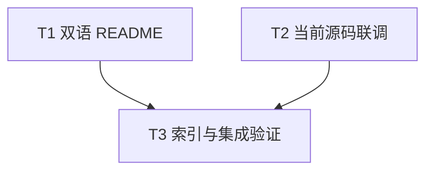

# rs-web 入门文档与下游当前源码联调实施计划

**目标：** 落实[同轮设计](design-20261013T160345113Z-029cf798.md)的两项已接受评审意见：在中英文 README 中提供可编译的最小接入路径，并让 rs-web CI 验证当前源码与 rs-websocket 的真实互操作测试。

**架构：** 文档任务只改变入门说明，不改变公共 API。联调任务作为 rs-web 独立 GitHub Actions workflow，临时检出下游，通过 Cargo source patch 把其固定 Git 依赖覆盖为当前 rs-web checkout；先核对依赖解析路径，再运行下游测试。现有固定 revision 的下游测试保留。

**技术栈：** Rust 2024／1.94.0，Axum 0.8，Tokio 1，Cargo、GitHub Actions、Python 3（仅用于 CI 中解析 `cargo metadata` JSON）。无新生产依赖。

**工作边界：** 本计划供下一位执行者实施。用户本轮只授权写入这份设计与计划；不得把计划中的 `git add`、`git commit`、`git push` 当作已获授权。执行时先核对当时工作树与适用规则，不覆盖现有用户改动。两份方案使用用户指定的 `rs-web/doc/` 精确路径；不另建临时方案文件。

## 文件与职责

| 路径 | 任务 | 职责 |
| --- | --- | --- |
| `README.md`、`README.zh_CN.md` | T1 | 同一最小服务的双语安装、完整代码、运行命令、结果与适用边界 |
| `.github/workflows/downstream-interop.yml` | T2 | 当前 rs-web 源码与下游 `web_interop_tests` 的独立门禁 |
| `doc/README.md` | T3 | 索引本轮设计与计划，明确“待实施”状态 |

## 调度图

| 任务 | 前置任务 | 最小解锁产物 | 写入集合 | 本地验证 | 集成验证归属 | 审查时机 |
| --- | --- | --- | --- | --- | --- | --- |
| T1 双语 README | 无；与 T2 同批 | 两版相同事实的完整最小例子，独立消费者编译且请求通过 | rs-web `README.md`、`README.zh_CN.md` | 临时消费者 `cargo +1.94.0 check`，loopback `curl`，双语／链接核对 | T3 | 批量审查 |
| T2 当前源码联调 | 无；与 T1 同批 | workflow 能证明 Cargo 使用本地 rs-web，并运行五个下游用例 | rs-web `.github/workflows/downstream-interop.yml` | 本地两仓 checkout 下的 `cargo metadata` 断言与 `cargo test --test web_interop_tests`；Cargo 资源组，与 T1 的编译命令串行 | T3 | 立即审查 |
| T3 索引与集成验证 | T1、T2 | 文档索引、最终差异检查及单一全量验证结果 | rs-web `doc/README.md`；验证失败回到所属任务修正 | Markdown 链接、workflow 内容、`git diff --check` | T3 独占 rs-web 全功能测试、格式和文档检查；Cargo 资源组串行 | 立即审查 |



## T1：让两版 README 在正文走通最小服务

**接口与边界：** 只改 `README.md`、`README.zh_CN.md`。最小例子使用 native Axum `/health` 与 `/admin/shutdown`；`RequestLimitLayer` 只安装到 `/health` 短路由。它不模拟现有 `controller_crud` 的 `/users`，也不声明 SSE/WS 路由已获得短请求限额。已有 CRUD 与流式示例的命令和链接继续保留。

- [ ] 在两版安装节为最小例子列出直接依赖：`axum = "0.8"`、`qubit-web = "0.2"`、`tokio = { version = "1", features = ["macros", "rt-multi-thread", "sync"] }`。若代码使用到额外 Tokio feature，必须同步依赖片段；默认 feature 为空的事实保持准确。
- [ ] 在两版快速开始正文加入同一份完整 Rust 代码，并分别用自然英文／中文解释执行顺序。核心结构须包含以下可核对调用链；实际文档应给出完整 import、`#[tokio::main]`、返回类型和所有变量绑定，不保留省略号：

```rust
let stop = std::sync::Arc::new(tokio::sync::Notify::new());
let stop_for_route = stop.clone();
let app = axum::Router::new()
    .route(
        "/health",
        axum::routing::get(|| async { "ok" })
            .layer(qubit_web::RequestLimitLayer::new(qubit_web::HttpLimits::default())),
    )
    .route(
        "/admin/shutdown",
        axum::routing::post(move || {
            let stop = stop_for_route.clone();
            async move {
                stop.notify_one();
                axum::http::StatusCode::ACCEPTED
            }
        }),
    );
let options = qubit_web::ServerOptions::new("127.0.0.1:3000".parse()?)
    .with_max_transport_connections(128)?;
let server = qubit_web::WebServer::bind_http(options).await?;
server.serve(app, async move { stop.notified().await }).await?;
```

- [ ] 把上述片段放入临时消费者 crate 的 `src/main.rs`，补齐 `#[tokio::main] async fn main() -> Result<(), Box<dyn std::error::Error>>`，按正文依赖运行 `cargo +1.94.0 check`。预期通过；若 Axum `Handler` 的状态／闭包约束不满足，先调整正文代码再复验。临时 crate 只用于验证，不把它当作第三份长期维护的示例。
- [ ] 运行消费者，依次请求 `curl -i http://127.0.0.1:3000/health` 与 `curl -i -X POST http://127.0.0.1:3000/admin/shutdown`。预期分别为 `200 OK`／`ok` 与 `202 Accepted`，随后服务进程退出。若端口已占用，只在临时消费者测试中改用空闲 loopback 端口，并记录该差异；README 固定示例仍与命令一致。
- [ ] 将现有 `/users` 创建请求明确标为完整 `controller_crud` 示例的验收步骤，避免读者把它发送给最小服务。核对两版安装版本、路由、状态码、短路由限额装配和停服方法语义一致；保留指南入口、语言切换和现有项目价值说明。

## T2：新增当前 rs-web 源码的下游互操作门禁

**接口与边界：** 仅新增 `.github/workflows/downstream-interop.yml`；不修改 rs-websocket 的 `Cargo.toml`、`Cargo.lock`、`tests/web_interop_tests.rs`，也不在 rs-web 引入循环 dev-dependency。当前下游五个测试函数分别覆盖消息与关闭、错误信息脱敏、服务端关闭、小消息上限和停服。

- [ ] 新建 workflow，触发条件与现有 rs-web CI 一致：main push、pull_request、workflow_dispatch；`permissions: { contents: read }`。在同一个 job 中用 `actions/checkout@v4` 将当前 rs-web 检出到 `rs-web/`，将 `qubit-ltd/rs-websocket` 的默认分支检出到 `rs-websocket/`；记录 `git -C rs-web rev-parse HEAD` 和 `git -C rs-websocket rev-parse HEAD` 到日志。安装 1.94.0 toolchain，不依赖 runner 默认 Rust 版本。
- [ ] 在 workflow 单一 shell step 中构造 Cargo 配置参数，保持元数据核对与测试命令完全一致：

```bash
PATCH_CONFIG="patch.\"https://github.com/qubit-ltd/rs-web\".qubit-web.path=\"${GITHUB_WORKSPACE}/rs-web\""
cargo +1.94.0 --config "$PATCH_CONFIG" metadata \
  --manifest-path rs-websocket/Cargo.toml --format-version 1 \
  > "${RUNNER_TEMP}/rs-websocket-metadata.json"
```

- [ ] 用 Python 3 解析该 JSON，找到依赖解析图中的 `qubit-web` package，断言唯一命中的 `manifest_path` 解析后等于 `${GITHUB_WORKSPACE}/rs-web/Cargo.toml`；找不到、出现多个候选或路径指向 Cargo Git cache 都必须使 job 失败。先在本地两个检出中试运行这一步，确认 Cargo patch 确实覆盖带 `rev` 的 Git 依赖。若不能覆盖，依据实际 Cargo 报错修订覆盖方式并重新执行路径断言；不得退回固定 revision 后继续声称当前源码联调通过，也不得修改持久化的下游 manifest。
- [ ] 解析断言通过后执行：

```bash
cargo +1.94.0 --config "$PATCH_CONFIG" test \
  --manifest-path rs-websocket/Cargo.toml --test web_interop_tests
```

预期五个测试通过。此当前源码测试不加 `--locked`，因为 source patch 会改变临时 lock 解析；确认产生的 lock 差异只在临时下游 checkout 中，未写回 rs-web 或 rs-websocket 工作树。保留固定 revision 的 rs-websocket 常规 CI，用于独立的锁定版本验证。
- [ ] 检查 workflow 的 YAML、触发事件、权限、路径与变量引号；本地复跑元数据断言和测试。若 GitHub 首次执行失败，先读取下游 SHA、Cargo 解析路径与测试失败信息，区分 checkout／网络、依赖解析与真实互操作回归，不绕过断言。

## T3：索引与最终验证

- [ ] 在 `doc/README.md` 的 Historical decisions／实施记录下加入本设计和计划的相对链接，注明状态是“待实施设计与计划”。现行架构、生命周期和用户指南仍保留在 Current architecture and usage，不把本方案描述成已经交付的行为。
- [ ] 核对设计要求到任务的覆盖：正文最小服务、双语事实、实例验证归 T1；本地源码 Cargo 解析断言、五个互操作用例、保留固定版本归 T2；索引、差异和全量验证归 T3。核对全部新增相对链接指向实际文件。
- [ ] 运行 `git status --short`、`git diff --check`、`git diff --stat` 检查写入范围；新 workflow 与两版 README 全文复读。运行 `cargo fmt --all -- --check`、`cargo test --workspace --all-features --all-targets`，记录退出码与测试摘要。若 Cargo 资源组被其他任务占用，等待或串行，不同时启动多次全量编译。文档中的可编译片段还需以 T1 的独立消费者结果证明，不能只凭仓库原测试通过。
- [ ] 交付说明分别列出：rs-web 原有测试结果、README 消费者结果、下游当前源码联调结果、GitHub workflow 是否已在 PR／main 实际运行。未运行的远端 CI 不写成“已通过”。本计划不授权提交、推送或修改下游工作树。

## 完成判据

1. 两版 README 读者只读正文即可从依赖配置走到服务运行、请求结果与停服；代码真实编译并能服务对应 `curl`。
2. 新 CI job 在测试前证明下游解析到 rs-web 当前 checkout，再运行 `web_interop_tests`；没有依赖源断言时不能把用例通过视为本目标完成。
3. 固定 Git revision 的下游测试仍可独立使用；rs-web 的现有全功能测试和格式检查通过；仅改动上表所列直接相关文件。
